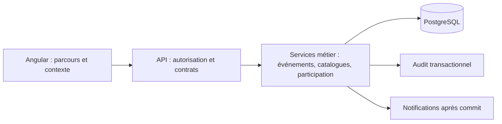

# Contrat d’architecture — Groupes associatifs

## Paradigme

Faire évoluer les modules métier V2 existants : Angular présente les données et appelle l’API ; les services Kotlin/Spring vérifient les droits, portent les règles et les transactions ; PostgreSQL conserve les données. Pas de branche métier par activité ni de moteur générique de workflow. Les évolutions des modules restent ciblées.

## Invariants

### AD-1 — V2 commune [ADOPTED]

- **Binds:** CAP-1 à CAP-7, CAP-9.
- **Prevents:** les variantes indépendantes théâtre/sport et une refonte générale prématurée.
- **Rule:** Étendre les parcours et services V2 existants uniquement aux points nécessaires aux capacités demandées.

### AD-2 — Identité stable [ADOPTED]

- **Binds:** rôles, types, disponibilités, sélections, préférences, statistiques et audit.
- **Prevents:** la rupture ou la fusion d’historiques lors d’un renommage.
- **Rule:** L’identité d’une définition est indépendante de son libellé ; les clés historiques et leur sens restent compatibles. Le libellé courant s’affiche dans les vues et statistiques ; les traces d’audit et contenus utilisateur conservent leurs données historiques. L’identité n’est jamais recyclée.

### AD-3 — Archivage des définitions [ADOPTED]

- **Binds:** catalogues de rôles et types.
- **Prevents:** les références historiques orphelines et la réutilisation involontaire.
- **Rule:** Une définition archivée reste résoluble pour les références existantes et n’est plus proposée lors de la création de nouveaux événements ou besoins. Les besoins déjà offerts sur un événement restent utilisables pour candidater et affecter ; l’archivage ne retire aucune place ni donnée référencée.

### AD-4 — Information sans confirmation [ADOPTED]

- **Binds:** validation et revalidation sans confirmation, notifications et tâches.
- **Prevents:** une demande de confirmation fictive et les notifications répétées.
- **Rule:** Informer les personnes nouvellement sélectionnées par un message distinct d’une demande de confirmation ; aucune tâche ni rappel de confirmation. Une revalidation inchangée est silencieuse ; après validation d’un remplacement, informer les personnes entrante et sortante. Les modifications de brouillon restent silencieuses. Les notifications suivent le commit de la mutation.

### AD-5 — Catalogues autonomes [ADOPTED]

- **Binds:** CAP-4 et CAP-5.
- **Prevents:** la propagation d’un changement de catalogue vers d’autres groupes.
- **Rule:** Chaque groupe possède ses définitions persistantes de rôles et de types, initialisées depuis les modèles existants. Ceux-ci ne sont pas une source d’héritage dynamique après initialisation. Les références historiques se résolvent avec l’identité du groupe ; chaque ajout est propre à celui-ci.

### AD-6 — Préférences de rôles par groupe [ADOPTED]

- **Binds:** préférences de membre, disponibilité, catalogues.
- **Prevents:** la propagation d’une préférence ou d’une clé personnalisée entre groupes.
- **Rule:** Les préférences de rôles appartiennent à l’adhésion et sont validées dans le catalogue du groupe. Initialiser depuis les préférences existantes : une liste explicite reste explicite et la valeur vide historique signifie toujours dynamiquement « tous les rôles » du groupe, y compris les futurs rôles. Une modification ultérieure affecte uniquement le groupe choisi. L’ancien chemin global sans contexte groupe ne doit plus écrire sur les adhésions : une mutation ambiguë échoue explicitement ; sa lecture ne prétend pas représenter les préférences d’un groupe. La transition des anciens clients est définie avant tout déploiement. Nom et genre du profil restent communs.

### AD-7 — Statistiques par rôle [ADOPTED]

- **Binds:** statistiques, catégories, rôles et types.
- **Prevents:** l’invisibilité des nouveaux rôles et le double comptage d’un événement multirôle.
- **Rule:** Compter disponibilités, sélections et retraits pour chaque rôle, y compris personnalisé ; compter une personne au plus une fois par événement dans le total d’événements. Un même calcul alimente interface et exports : conserver les prédicats historiques de sélection et de candidatures wildcard, en y intégrant `SELECTED` comme engagement. Préserver les regroupements et calculs théâtre existants sans classer automatiquement les rôles ajoutés dans Jeu, Décorum ou Bénévolat. Conserver catégories et filtres même sans tirage. Une sélection ne prouve pas une présence réelle.

### AD-8 — Tirage et rôles ajoutés [ADOPTED]

- **Binds:** tirage, parité, formules et rôles personnalisés.
- **Prevents:** l’attribution implicite de la sémantique `player` ou `volunteer` à un rôle ajouté.
- **Rule:** Lorsque le tirage est autorisé pour l’événement, tous les rôles offerts sont éligibles, y compris les rôles ajoutés, avec les facteurs communs existants calculés selon leur identité et historique propres. Par défaut, conserver l’ordre historique des rôles existants puis traiter les rôles ajoutés selon un ordre stable défini par le catalogue, avec départage par identité stable. Un administrateur peut définir la priorité des rôles dans une section dédiée aux réglages du tirage ; la priorité choisie est commune au tirage et aux simulations futurs. Un changement de priorité ne réécrit ni les résultats ni les snapshots de chances déjà enregistrés. Préserver les exclusions inter-rôles du tirage et l’indicateur de parité dans son périmètre ; aucune classification automatique ni configuration de parité par rôle. Les rôles restent disponibles pour sélection manuelle et statistiques sans tirage.

### AD-9 — Initialisation des groupes [ADOPTED]

- **Binds:** création de groupe et réglages.
- **Prevents:** des comportements initiaux divergents entre groupes et la régression des usages existants.
- **Rule:** Initialiser un nouveau groupe avec tirage autorisé, bénévolat obligatoire si des places `volunteer` sont proposées, et confirmation requise par défaut ; le type peut choisir sa règle de confirmation ou hériter du groupe. Un administrateur peut ensuite modifier ces défauts pour les nouveaux événements.

### AD-10 — Vocabulaire contextuel [ADOPTED]

- **Binds:** CAP-1, CAP-2, CAP-9 et vues multigroupes.
- **Prevents:** la contamination entre groupes et la dépendance à une traduction générale.
- **Rule:** Les termes communs sont Groupe, Événement, Type et Sélection. Un groupe peut personnaliser uniquement ces concepts ; les rôles sont nommés dans son catalogue. Saison, Dispos et Équipe ne changent pas par implication. Une surface, notification ou message généré rattaché à un groupe utilise ses termes et leurs formes explicites ; le chrome multigroupe et les contenus sans groupe univoque utilisent les termes communs. Une forme absente retombe sur la forme commune. Appliquer aussi aux noms accessibles, aides et erreurs. Les contenus utilisateur et traces d’audit ne sont pas réécrits.

### AD-11 — Réouverture et désistement [ADOPTED]

- **Binds:** sélection sans confirmation, verrouillage et remplacements.
- **Prevents:** la perte des engagements et la réaffectation implicite d’une personne désistée.
- **Rule:** Déverrouiller conserve les engagements ; revalider sans changement les conserve. Le désistement libère la place et reste dans l’historique ; une revalidation ne réaffecte pas automatiquement la personne. Une nouvelle affectation devient engagement lors de sa validation explicite par l’organisateur, y compris le remplissage autorisé d’une place libre dans une sélection déjà validée.

### AD-12 — Sélectionné distinct de confirmé [ADOPTED]

- **Binds:** états, API, interface, audit, statistiques, notifications et rappels.
- **Prevents:** la présentation d’une décision de l’organisateur comme une confirmation du membre.
- **Rule:** Après validation sans confirmation, une affectation porte l’état persistant `SELECTED`, exposé `selected` dans le contrat API, distinct d’une projection statistique et d’une affectation de brouillon. `CONFIRMED` conserve sa sémantique existante de confirmation, y compris une confirmation enregistrée par proxy avec sa provenance. Les deux états représentent un engagement opérationnel et permettent le désistement, sans prouver la présence réelle. Une équipe dont les places requises sont engagées ou dispensées est complète ; son libellé ne prétend pas que tous ont confirmé. Pour un événement sans confirmation, aucune action de confirmation, y compris par proxy ou agenda, n’est proposée ni acceptée par l’API. Les tâches et rappels de confirmation excluent `SELECTED` ; conserver les couleurs de participation. Tous les lecteurs d’état, API et anciens clients doivent gérer explicitement cette valeur lors de la transition.

### AD-13 — Règles effectives par événement [ADOPTED]

- **Binds:** CAP-3, CAP-5, CAP-6, CAP-7 et création d’événement.
- **Prevents:** la rétroactivité des réglages et les désaccords entre affichage, API et notifications.
- **Rule:** À la création, le serveur résout et persiste transactionnellement les règles effectives de tirage, d’obligation bénévole (défaut du groupe uniquement) et de confirmation, ainsi que les besoins issus du type, sur une vue cohérente des défauts. Le choix de confirmation du type est « hériter », « requis » ou « non requis » ; seuls les besoins explicitement fournis et validés à la création remplacent les besoins par défaut. Les consommateurs utilisent les règles de l’événement, jamais les défauts courants pour réinterpréter un événement existant. En bénévolat facultatif, joueur seul, bénévole seul ou les deux sont valides lorsque les rôles correspondants sont offerts ; validation identique pour soi et proxy. Les besoins restent éditables ; un changement de type ne les réinitialise pas implicitement et ne modifie pas les règles effectives. Cette persistance ne crée pas d’éditeur d’override de confirmation ou bénévolat. Le tirage et ses simulations sont refusés côté API lorsque la règle effective le désactive ; les données et contrôles de formule, explications et probabilités ne sont pas exposés dans les parcours de l’événement, y compris le choix manuel de candidats, qui reste disponible. Les couleurs d’état restent visibles.

### AD-14 — Autorité et isolation [ADOPTED]

- **Binds:** catalogues, règles, préférences, navigation et vues agrégées.
- **Prevents:** les accès ou références d’un groupe utilisés dans un autre.
- **Rule:** Le serveur dérive le groupe autorisé depuis l’événement, sa saison ou l’adhésion ciblée et vérifie qu’une définition appartient à ce groupe. Les contrôles d’accès et privilèges existants restent applicables. Chaque élément d’un agrégat multigroupe utilise son propre contexte ; le groupe mémorisé de navigation ne fait pas autorité sur un événement. L’audit accompagne la mutation dans sa transaction.

### AD-15 — Transition compatible [ADOPTED]

- **Binds:** données historiques, catalogues, règles effectives et déploiements.
- **Prevents:** la réinterprétation des événements, références et réponses existants.
- **Rule:** Définir une correspondance vérifiable des clés et règles historiques avant toute migration ; les anciens événements conservent leur comportement V2 effectif, y compris les règles spécifiques des types existants comme `deplacement`, et les préférences vides ainsi que les candidatures historiques wildcard gardent leur sens. Préserver identités, affectations, historiques, audit et snapshots de chances. Coordonner la prise en charge du nouvel état par les lecteurs, écrivains, clients PWA et rollback avant toute écriture de cet état ; assurer la compatibilité des lectures/écritures pendant une transition mixte ou empêcher cette transition. Prévoir vérification et retour arrière documentés avant exécution.

## Conventions de cohérence

| Sujet | Règle |
| --- | --- |
| Identités et contrats | Les noms techniques et routes existants peuvent rester stables ; ne pas renommer les données pour changer la copy. Les identités personnalisées sont résolues dans le contexte du groupe et ne peuvent entrer en collision avec les modèles historiques. |
| Navigation | Nom et logo du groupe résolu, avec repli accessible ; groupe, saison et statistiques suivent le même contexte autorisé, y compris après changement ou échec de chargement. |
| Résolution | L’API est autorité des règles effectives ; le client les consomme pour présenter les actions autorisées. Les formulaires self et proxy appliquent la même politique bénévole effective. |
| Accessibilité | Angular Material 3, tokens existants, mobile-first et checklist `docs/v2/technical/FRONTEND_UI.md` ; distinguer état et probabilité sans s’appuyer sur la couleur seule. |
| Opérations | Réutiliser l’enveloppe V2 Angular, API Spring, PostgreSQL/Neon et environnements existants. Aucune nouvelle infrastructure ou promotion n’est décidée par ce contrat. |

## Capacités couvertes

| Capacité | Frontière | Invariants |
| --- | --- | --- |
| CAP-1 / CAP-9 | Copy commune et vocabulaire du groupe | AD-1, AD-10, AD-14 |
| CAP-2 | Navigation, groupe et saison | AD-10, AD-14 |
| CAP-3 | Tirage, simulations, probabilités et catégories | AD-7, AD-8, AD-13, AD-14 |
| CAP-4 | Catalogue de rôles et consommateurs | AD-2, AD-3, AD-5 à AD-8, AD-14, AD-15 |
| CAP-5 | Catalogue de types et besoins événement | AD-2, AD-3, AD-5, AD-7, AD-13 à AD-15 |
| CAP-6 | Bénévolat et disponibilités self/proxy | AD-9, AD-13 à AD-15 |
| CAP-7 | Sélection, engagement et notifications | AD-4, AD-11 à AD-15 |

## Différé et réconciliation

- **CAP-8 / Q-5 — séries :** besoin d’entraînement non confirmé ; pas de modèle de récurrence, d’exceptions ou d’édition groupée dans ce contrat. Reprendre après confirmation du besoin.
- **CAP-10 / Q-4 — mode simple :** besoin non confirmé ; pas d’état, de statistiques ou de workflow dédié. Reprendre après confirmation du besoin.
- **Spec amont :** les deux reports ci-dessus contredisent le périmètre initial de la spec ; la mettre à jour via `bmad-spec` avant de découper l’epic et ses stories, ainsi que ses companions concernés. Les contrats racine `SPEC.md`, `DOMAIN.md` et `ARCH.md` devront être alignés lors de l’implémentation ; l’architecture cible ne décrit pas le runtime actuel.
- **Choix locaux :** forme physique des tables, noms de champs et migration détaillée, libellés grammaticaux précis, tri des rôles, interface de configuration et tests détaillés appartiennent aux unités d’implémentation tant qu’ils respectent les invariants ci-dessus.
- **Rappels informatifs et réglages fins :** préciser la copy et les canaux au niveau de l’implémentation, sans nouvelle demande de confirmation ni création de tâche pour « sélectionné ».
