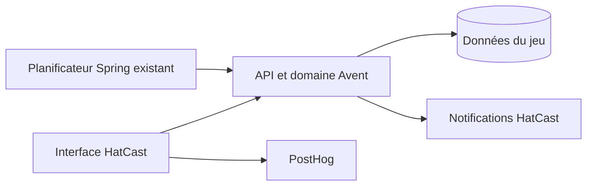

# Architecture Spine — Calendrier de l’Avent La Malice

## Paradigme

L’interface Angular présente les parcours ; l’API HatCast contrôle l’accès, les dates et les mutations du jeu ; PostgreSQL conserve les données partagées. Les notifications et l’analytics sont des effets associés au jeu, jamais la source des scores.

## Invariants et règles

### AD-1 — Accès et confidentialité [ADOPTED]

- **Binds:** FR-1, FR-4, FR-10, FR-13 ; contenus et portraits.
- **Prevents:** Accès hors troupe, révélation anticipée par le client ou privilège générique d’administration.
- **Rule:** L’API autorise uniquement les membres actifs de la troupe configurée pour l’environnement et applique les dates et modes autorisés à chaque lecture et mutation. Le privilège d’administrateur plateforme ne dispense pas de cette appartenance. Les quiz futurs, leurs réponses et portraits révélateurs ne sont pas distribués au client avant autorisation, notamment dans les bundles ou caches publics ; la bonne réponse du quiz jouable ne l’est qu’après confirmation ou selon les règles de consultation du PRD.

### AD-2 — Essais isolés et configuration [ADOPTED]

- **Binds:** FR-13 ; environnements et opérations de test.
- **Prevents:** Exposition anticipée en production et contamination du jeu réel.
- **Rule:** Le mode test n’existe qu’en développement isolé, jamais en production ; il rend disponibles les cases fournies avant leur date pour tous les membres actifs de la troupe configurée et indique visiblement le mode. Une bonne réponse à une case future rapporte 3 points en test. La troupe cible est configurable par environnement. Les réponses suivent le parcours définitif et une remise à zéro ciblée des données de développement permet de recommencer. Vérifier l’isolation effective de la base, des notifications et de l’analytics avant les essais.

#### Simulation de novembre — précision validée

Sur le serveur de développement isolé uniquement, un jeu de 25 quiz aux affirmations fictives est disponible pour les essais. Les noms et portraits peuvent être ceux de membres réels de La Malice, avec leur accord ; leur utilisation en test ne décide pas du contenu final. Du 1er au 25 novembre 2026, le jour de novembre correspond au même jour de décembre : cette date simulée gouverne les états, parcours quotidiens, scores et bonus de régularité des réponses de test. Les fonctionnalités de test sont accessibles avant décembre. Les membres actifs de la troupe configurée peuvent également ouvrir librement les cases disponibles avant leur jour simulé ; une bonne réponse future rapporte 3 points. Les réponses sont définitives jusqu’à une remise à zéro ciblée en développement. Contenus fictifs, réponses, notifications et analytics de test restent isolés de la production ; aucun mode test ni affirmation fictive de test n’y est accessible. La consultation du classement final est testable en développement à partir du 25 novembre ; si un accès anticipé devient nécessaire, il fera l’objet d’une story dédiée. Les frontières réelles de décembre et janvier sont vérifiées séparément.

### AD-3 — Réponses et état partagés [ADOPTED]

- **Binds:** FR-2, FR-4 à FR-7, FR-10.
- **Prevents:** Réponses multiples, scores contradictoires ou perte du parcours entre appareils.
- **Rule:** L’API est seule autorité pour la disponibilité, l’heure et le score ; la base garantit une réponse définitive par membre et case, y compris sous concurrence ou après réessai. Après interruption ou conflit, le client peut retrouver le résultat enregistré sans créer une seconde réponse. Une réponse conserve le choix, la bonne affirmation et les points nécessaires à restituer fidèlement son résultat. La fermeture quotidienne de l’ouverture automatique et l’état de résultat non vu sont persistés par membre, avec les priorités et limites temporelles du PRD ; la seule émission d’une réponse HTTP ne marque pas le résultat comme vu.

### AD-4 — Classement et conservation [ADOPTED]

- **Binds:** FR-5, FR-8 à FR-10 ; données après l’animation.
- **Prevents:** Scores divergents et perte des résultats après la période de consultation.
- **Rule:** Les scores proviennent des réponses enregistrées ; le classement inclut les membres classables sans réponse, applique les rangs 1, 1, 3 et exclut les deux comptes désignés, dont le score reste personnel. Il devient final à la clôture du jeu. Les réponses et résultats sont conservés après le 15 janvier ; l’accès membre cesse le 16 janvier. Aucun mécanisme spécifique aux changements d’adhésion après clôture n’est prévu.

### AD-5 — Invitation quotidienne [ADOPTED]

- **Binds:** FR-3 ; notifications.
- **Prevents:** Invitations multiples, notifications aux membres ayant déjà répondu et envoi pour un quiz publié après 9 h.
- **Rule:** Réutiliser le planificateur Spring et les mécanismes habituels des rappels HatCast, sans infrastructure, reprise ni garantie supplémentaires propres à l’Avent. Le traitement vise 9 h Europe/Paris du 1er au 25 décembre et applique les règles du PRD : quiz disponible, membre sans réponse et préférences habituelles ; aucun envoi de rattrapage pour un quiz publié après 9 h. Adapter le circuit de notification sans créer de spectacle fictif.

### AD-6 — Mesure de participation [ADOPTED]

- **Binds:** Réussite ; PostHog.
- **Prevents:** Confusion entre nombre de joueurs et réponses, mélange des essais et données réelles, exposition de contenus.
- **Rule:** Mesurer deux totaux globaux : personnes distinctes ayant au moins une réponse réelle enregistrée et réponses réelles enregistrées. Exclure les essais de développement et ne transmettre ni anecdotes, ni affirmations, ni choix. La base fait autorité si la télémétrie est manquée ; aucune ventilation par jour n’est requise.

## Conventions

- Dates, dates de confirmation et limites de jeu : heure civile Europe/Paris, calculée côté serveur.
- Contenus intégrés par release, sans interface d’administration ; la bonne réponse ne change pas après une première réponse.
- Interface et accessibilité : les documents UX finalisés et les conventions Angular Material HatCast gouvernent les parcours et composants.
- Le développement et la production possèdent des configurations et données isolées ; la vérification opérationnelle précède toute démonstration.

## Points reportés à l’implémentation

- Les invitations héritent des limites opérationnelles des rappels existants ; aucun traitement de reprise spécifique à l’Avent n’est prévu.
- Définir la procédure sûre et ciblée de remise à zéro en développement et les garde-fous effectifs interdisant son usage en production.
- Définir l’accès ultérieur aux données conservées si le besoin se présente ; aucune nouvelle interface n’est prévue ici.
- Vérifier les implications opérationnelles des changements de contenu et de la conservation des résultats, notamment portraits, cache client et cycle de release.
