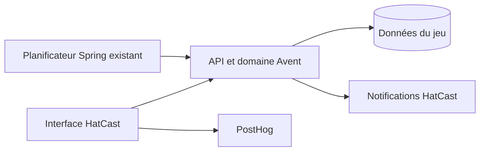

# Architecture Spine — Calendrier de l’Avent La Malice

> Le PRD, la spec et l’epic 25 sont réconciliés avec les décisions ci-dessous ; les critères et dépendances des stories révisées ont été validés avec Patrice le 29 octobre 2026.

## Paradigme

Angular présente les parcours ; l’API contrôle accès, temps, divulgation et mutations ; PostgreSQL conserve l’état partagé. Notifications et analytics ne font pas autorité sur les scores.

## Invariants et règles

### AD-1 — Accès et confidentialité [ADOPTED]

- **Binds:** FR-1, FR-4, FR-6, FR-10, FR-11, FR-13 ; contenus, API et caches.
- **Prevents:** Accès hors troupe et divulgation des contenus futurs ou de la justesse avant révélation.
- **Rule:** L’API vérifie à chaque lecture et mutation l’appartenance active à la troupe configurée et les dates et modes autorisés ; l’administration plateforme ne dispense pas de cette appartenance. Les contenus futurs, réponses correctes et compléments révélateurs ne figurent ni dans les bundles, assets publics, caches partagés, notifications ou analytics, ni dans une réponse API anticipée. Pour un quiz jouable, l’API ne fournit que portrait et trois anecdotes ; jusqu’à minuit Paris suivant son jour, aucune réponse, erreur, métadonnée ou donnée dérivée accessible ne révèle sa justesse ou ses points, y compris pour d’autres membres. Les réponses et scores en attente restent côté serveur. Les portraits sensibles et leurs URL directes sont soumis aux mêmes contrôles. Les lectures sensibles sont privées et non mises en cache (`Cache-Control: no-store`) ; service worker, stockage client et intermédiaires ne doivent pas conserver ou servir des données Avent sensibles périmées ou destinées à un autre compte. La protection ne couvre pas le partage volontaire par une personne ayant découvert un contenu.

### AD-2 — Essais isolés et configuration [ADOPTED]

- **Binds:** FR-13 ; développement, simulation et opérations.
- **Prevents:** Accès au mode test en production ou contamination de la partie réelle.
- **Rule:** Le mode test existe exclusivement en développement isolé, jamais en production ; il est visible et accessible aux membres actifs de la troupe configurée figurant sur la liste dédiée des testeurs. Cette liste ne confère aucun rôle d’administration de troupe ou de plateforme. Les cases disponibles peuvent être ouvertes avant leur jour en test ; les réponses restent définitives jusqu’à une remise à zéro ciblée. Utiliser des anecdotes fictives et, avec accord, éventuellement des noms ou portraits réels. Isoler effectivement données, notifications et analytics de production et interdire côté serveur toute commande de simulation ou de reset en production. Une horloge simulée commune côté serveur permet de régler la date et l’heure en avançant uniquement ; revenir en arrière exige une remise à zéro ciblée de la partie de test et de son horloge. Répondre à une case future avance automatiquement l’horloge simulée jusqu’au jour de cette case ; appliquer le barème normal, puis révéler le résultat le lendemain simulé. L’ancien barème et la simulation de 25 quiz ne sont plus applicables. Tester séparément les vraies limites temporelles de production sans autoriser une horloge simulée en production.

### AD-3 — Réponses et état partagés [ADOPTED]

- **Binds:** FR-2, FR-4 à FR-7, FR-10, FR-11.
- **Prevents:** Double réponse, calcul incohérent, perte ou divulgation du résultat entre appareils.
- **Rule:** Le serveur applique les jours civils Europe/Paris : les quiz 1 à 24 acceptent une confirmation de 00 h inclus à 00 h le lendemain exclu ; toute confirmation attendant encore le verrou à la limite est fermée, même si elle a été reçue avant minuit. La révélation attend la fin d’une transaction déjà en cours. La base garantit une réponse définitive par membre et quiz sous concurrence et réessai ; une transaction sérialise pour un membre les mutations nécessaires au calcul. L’API permet de résoudre une confirmation incertaine sans deuxième réponse et ne retourne qu’un accusé avant révélation. Conserver choix et informations nécessaires à restituer fidèlement le résultat ; la fausse anecdote ne change plus après une première réponse. Calculer 10 ou 0 points de réponse, 1 de participation et 2 par groupe non chevauchant de trois bonnes réponses successives ; une mauvaise rompt la série, un jour manqué ne la rompt pas. Ces données sont conservées mais non exposées avant révélation. Les totaux et rangs n’intègrent que les réponses dont le lendemain a commencé à Paris, indépendamment de la consultation par le membre.

La fermeture de l’ouverture automatique est persistée par membre et jour, y compris si le contenu apparaît plus tard ; une visite sans contenu ne la consomme pas. La réponse enregistrée empêche l’ouverture automatique sur tous les appareils. Pour le retour, présenter en priorité le résultat non vu de la réponse révélable la plus récente, même si une réponse plus récente attend encore sa révélation ; les résultats plus anciens restent consultables dans leurs cases. Ne marquer vu qu’après affichage effectif de l’écran via un accusé explicite du client, idempotent et persisté côté serveur ; une réponse HTTP perdue avant affichage ne suffit pas. Une interruption ou deux appareils concurrents peuvent afficher le même résultat avant que l’accusé soit reçu : ne pas prétendre garantir un affichage unique distribué ; après enregistrement du vu, les accès suivants en tiennent compte. La consultation d’une case révélée ne rejoue pas la célébration.

### AD-4 — Classement et conservation [ADOPTED]

- **Binds:** FR-5, FR-8 à FR-10 ; conservation après l’animation.
- **Prevents:** Indices via score ou rang, classements incohérents et perte des résultats.
- **Rule:** Calculer chaque score personnel et chaque classement exclusivement à partir des points révélables au même instant de référence serveur ; ne publier aucun sous-total, évolution ou indicateur permettant de déduire la justesse ou les points en attente. Inclure tous les membres classables même sans réponse ; attribuer aux ex æquo le rang le plus bas du groupe (1, 3, 3, 4 ; tous à égalité = rang N). Exclure les comptes de Patrice et Toinou du classement tout en conservant leur score personnel. Le 25 décembre à 00 h Paris, les résultats du 24 deviennent révélables et le classement devient final ; aucun quiz du 25 et aucune réponse après le 24. Conserver réponses et résultats après le 15 janvier ; l’accès membre cesse le 16 janvier à 00 h Paris. Aucun mécanisme spécifique aux changements d’adhésion après clôture n’est prévu.

### AD-5 — Invitation quotidienne [ADOPTED]

- **Binds:** FR-3 ; notifications.
- **Prevents:** Invitation sans quiz disponible à 10 h ou adressée aux membres ayant déjà répondu.
- **Rule:** Réutiliser le planificateur Spring et les mécanismes habituels de rappels HatCast, sans infrastructure, reprise ni garantie supplémentaires propres à l’Avent. Viser 10 h Europe/Paris du 1er au 24 décembre ; à son exécution effective, vérifier la disponibilité du quiz du jour, l’absence de réponse et les préférences habituelles. Un quiz publié après 10 h peut être invité si le traitement démarre après sa publication ; une notification manquée est acceptée. Aucun horodatage dédié ni reprise spécifique. Le lien ouvre le parcours avec priorité à la révélation ; aucun spectacle fictif. Le circuit actuel associe notifications et déduplication à un spectacle : l’adapter à une identité de quiz et de destinataire, sans créer de spectacle factice. Les limites de disponibilité et de déclenchement des rappels existants restent applicables ; le mécanisme choisi ne garantit pas un envoi à heure exacte.

### AD-6 — Mesure de participation [ADOPTED]

- **Binds:** Réussite ; PostHog.
- **Prevents:** Mélange des essais et du jeu réel, exposition de contenus et confusion entre personnes et réponses.
- **Rule:** Mesurer deux totaux globaux : personnes distinctes ayant au moins une réponse réelle enregistrée et réponses réelles enregistrées. Exclure les essais et ne transmettre ni anecdotes, affirmations, choix, justesse ou points en attente. La base fait autorité si la télémétrie est manquée ; aucune ventilation par jour n’est requise.

## Conventions et vérifications

- Toute décision temporelle utilise une référence serveur cohérente, jamais l’horloge du navigateur. Les contenus sont intégrés par release, sans back-office.
- Un quiz publié pendant son jour devient jouable jusqu’à minuit ; publié après son jour, il est consultable après révélation sans réponse ni points. La notification vérifie la disponibilité à l’exécution effective, selon AD-5.
- Les cases passées non jouées ne deviennent consultables qu’après leur date de révélation. Les écrans du 25 et après respectent la priorité de révélation et l’UX révisée.
- Angular Material et les documents UX gouvernent l’interface. Les configurations, données et effets de développement et de production sont isolés.
- Vérifier API directes, navigateur, service worker et caches sur deux comptes et appareils ; tester concurrence, réessai, 23:59:59/00:00 Paris, 24/25 décembre et 15/16 janvier, y compris contenu publié tardivement et séries interrompues ou non par un jour manqué.

## Questions ouvertes et relais

- **PRD :** reformuler FR-3 simplement : tentative d’invitation à 10 h, sous réserve du quiz disponible à l’exécution et des conditions habituelles ; envoi éventuellement tardif ou manqué sans gravité. Un quiz publié après 10 h peut être invité si le job est retardé. Réconcilier aussi FR-4 avec l’heure de réception à l’API et FR-7 avec le résultat révélable non vu le plus récent.
- **Implémentation :** définir la procédure de reset ciblé, les garde-fous d’isolation ; vérifier les conditions de concurrence, de livraison des notifications et de publication par release. Définir l’accès ultérieur aux données conservées si nécessaire.
- **Spec :** réconcilier FR-1–FR-13 et AD-1–AD-6 : 24 quiz, confidentialité et projection révélée, frontières Paris, unicité, deux composantes de bonus, dernier résultat non vu, consultation des cases manquées, rangs, 25, notification et simulation retenue ; préserver rétention et mesure compatibles.
- **Epic 25 :** les critères et dépendances des stories 25.1, 25.2, 25.2a, 25.3–25.7 et 25.9 ont été révisés et validés avec Patrice le 29 octobre 2026. Couvrir les tests de fuite et caches, minuit, concurrence, reprise multi-appareils, série et frontières réelles.

**Reveal serialization contract (25.3/25.4):** Future result and ranking reads must acquire the same singleton clock row lock as confirmation, then sample authoritative time after acquiring it and read committed answers before releasing it. This serializes a reveal with in-flight confirmations so its scoring snapshot cannot subsequently change. A stalled transaction can delay the read beyond midnight; immediate wall-clock availability is therefore not guaranteed. Story 25.3 must implement and test this contract, including rollback and concurrent reads, on PostgreSQL.
