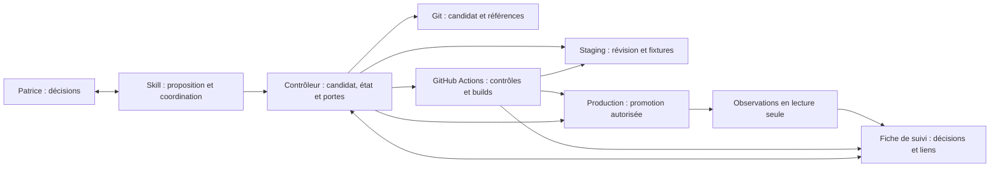
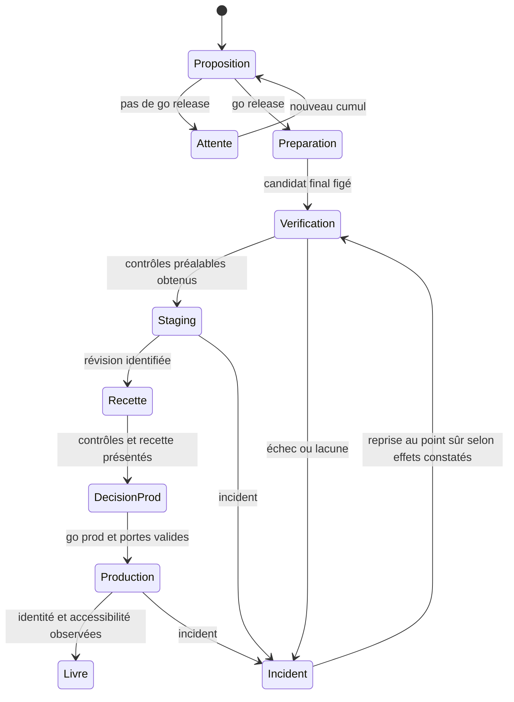

# Architecture — livraison V2

## Paradigme et responsabilités

Une orchestration par états, pilotée par l'opérateur, sépare les décisions humaines, les contrôles mécaniques et les effets externes. Cette architecture décrit une **cible**, pas la chaîne actuelle.

## Invariants et règles

### AD-1 — Cumul et candidat figé [ADOPTED]

- **Binds:** CAP-1, CAP-10 ; évaluation, préparation et reprise.
- **Prevents:** livraison partielle ou inclusion implicite de commits ultérieurs.
- **Rule:** Évaluer tout le delta entre la production réellement servie et `v2`. Attendre ou livrer tout le cumul ; aucune extraction. Après go release et approbation des notes, figer le commit final comprenant version et notes, sa version et son RC ; enregistrer aussi la base de production. Les merges ultérieurs restent pour la release suivante. Un correctif de code change le candidat et impose une nouvelle évaluation des contrôles affectés.

### AD-2 — Autorité et transitions [ADOPTED]

- **Binds:** CAP-6, CAP-8, CAP-10 ; skill et contrôleur.
- **Prevents:** démarrage ou promotion implicite, confusion avec l'intégration d'une story.
- **Rule:** Avant tout travail de release, présenter parcours, scénarios bloquants et différés, omissions et risques ; le go release porte sur ce périmètre. Toute lacune nouvelle est soumise à Patrice avant poursuite. Après résultats et recette staging, un go prod distinct autorise la promotion. Vérifier candidat, staging et preuves valides immédiatement avant promotion. Les preuves et accords de story gardent leur autorité propre.

### AD-3 — Fiche et preuves [ADOPTED]

- **Binds:** CAP-1, CAP-3, CAP-8, CAP-9 ; contrôleur et Actions.
- **Prevents:** preuve d'un autre candidat, couverture fictive ou perte des décisions.
- **Rule:** Le contrôleur est l'unique propriétaire des transitions de la fiche durable et partageable entre sessions ; chaque mise à jour vérifie la version précédente afin d'éviter les décisions concurrentes. La fiche liée au candidat indexe état, périmètre et décisions humaines, avec liens vers les exécutions Actions ; les rapports automatisés restent dans Actions. Pour chaque contrôle, conserver identité du run et tentative, sélection et assertions exécutées, résultat, skips, échecs et décisions ; pour l'humain, révision, rôle/fixture, actions, résultat persistant et contexte utile. Actions doit rendre le détail nécessaire accessible aussi en cas de succès. Si indisponible, la preuve est manquante. Ne stocker aucun secret. Distinguer durées de travail, attentes, relances, annulations et incidents sans additionner les travaux parallèles.

### AD-4 — Validité et résultats [ADOPTED]

- **Binds:** CAP-3, CAP-6 ; recherche Actions et portes.
- **Prevents:** réemploi de résultats insuffisants ou interprétation d'un skip comme succès.
- **Rule:** Retrouver les runs par candidat exact, workflow, tentative et sélection ; vérifier couverture, contrat de test, dépendances, configuration et fixtures pertinentes. Une preuve staging identifie le commit testé, la révision servie avant et après le run et la génération d'occupation staging ; si l'identité ou la continuité n'est pas établie, elle est rejetée. Ne pas supposer que le hash de `version.txt` est le SHA du commit RC : relier explicitement commit, build, image et révision. Un changement pertinent invalide la preuve affectée ; l'ascendance seule ne suffit pas. CI est la référence T1 ; E2E local à la demande ne remplace pas une preuve CI manquante. Préserver échec initial et relance. Si une vérification liée aux changements échoue puis réussit sans cause identifiée, présenter les deux résultats, l'analyse et le risque à Patrice : sa décision de poursuivre n'est pas une réussite sans réserve. Une lacune critique doit être vérifiée avant livraison ; une lacune hors périmètre critique ne peut être acceptée que selon le contrat et avec son risque explicite.

### AD-5 — Sélection et fixtures [ADOPTED]

- **Binds:** CAP-5, CAP-6 ; sélection CI et staging.
- **Prevents:** sélection par noms de fichiers seuls ou couverture supposée d'un effet métier.
- **Rule:** Pour tout le cumul, relier changement et voisin par dépendance → risque → scénario, puis associer IDs de tests, projets, assertions et fixtures ou recette humaine. Une condition ciblée inconnue ou fausse conduit au complet. Socle staging dans les deux cas : version, santé API, chargement PWA et C1 humain ; C2–C5 selon impacts en ciblé, tous en complet ; ajouter scénarios changements/voisins dans les deux. Une assertion ne démontre que ce qu'elle vérifie ; notamment E1-MEM-031/032 sont ignorés sur staging et E1-ORG-001–002 peut ne contrôler que l'affichage. Utiliser uniquement des fixtures staging réservées, adaptées et sûres pour les mutations ; une fixture critique manquante bloque la vérification. La construction des parcours n'attend pas l'automatisation intégrale.

### AD-6 — Staging partagé et différés [ADOPTED]

- **Binds:** CAP-6, CAP-8 ; contrôleur, Actions, staging.
- **Prevents:** collision de releases, opérations résiduelles et preuves mélangées.
- **Rule:** Les tests différés optionnels sont des runs Actions séparés, identifiés par candidat et révision staging, démarrés automatiquement après contrôles bloquants ; ils peuvent continuer pendant/après la MEP sans la retarder. Le contrôleur accorde une génération exclusive de mutation staging ; il la ferme avant remplacement, annule les seuls runs différés précédents et confirme l'arrêt de leurs opérations et fixtures possédées. Si cet arrêt n'est pas établi, diagnostiquer avant remplacement. Une fixture partagée existante ne devient pas isolée par simple étiquetage. Conserver résultats partiels et échecs, marquer le reste incomplet et rejeter les résultats tardifs ou mixtes. Les échecs sont diagnostiqués et soumis à Patrice, sans rollback automatique. Si une autre release demande staging avant la MEP de la première, demander à Patrice laquelle poursuivre avant remplacement ; aucun choix automatique. Un merge `v2` n'est pas un remplacement.

### AD-7 — Exécution et reprise [ADOPTED]

- **Binds:** CAP-2, CAP-4, CAP-8 ; contrôleur et déploiement.
- **Prevents:** déploiement spéculatif, reprise sur un candidat différent ou confusion des effets.
- **Rule:** Tous les chemins de mutation staging et production, y compris push, tag et déclenchement manuel, doivent respecter les mêmes portes et l'identité figée ; une convention opérateur seule n'est pas une protection. Les opérations ciblent explicitement le SHA/RC retenu et ne sélectionnent pas implicitement le dernier RC ou le `v2` courant. Builds et tests peuvent se chevaucher ; le déploiement staging attend les vérifications bloquantes requises. Un seul cycle staging valide le candidat final ; les builds et images staging et production restent distincts. Après incident, constater séparément références Git, publication, images, déploiements, version et trafic effectivement servis ; reprendre le même candidat au dernier point sûr avec les preuves encore valides. Ne pas réécrire les tags. Production : observations d'identité et d'accessibilité en lecture seule, sans parcours métier. Identifier cible et limites de retour arrière, notamment données, notifications et PWA.

## Modèle d'état opérationnel

Les différés sont une activité parallèle attribuée au candidat, pas un état qui réserve staging après livraison. Un diagnostic peut suspendre n'importe quelle transition ; le schéma ne confère aucune autorisation implicite.

## Correspondance des capacités

| Capacité | Responsabilité | Décisions |
| --- | --- | --- |
| CAP-1, CAP-3 | Contrôleur, fiche, Actions | AD-1, AD-3, AD-4 |
| CAP-2, CAP-4 | Préparation, Actions, staging | AD-1, AD-7 |
| CAP-5, CAP-6 | Skill, sélection, staging | AD-2, AD-4, AD-5, AD-6 |
| CAP-8 | Contrôleur, Git, Actions, Cloud Run | AD-2, AD-3, AD-6, AD-7 |
| CAP-9 | Fiche et exécutions Actions | AD-3 |
| CAP-10 | Skill et évaluation cumulative | AD-1, AD-2 |

## À préciser avant implémentation

- Le support concret de la fiche et les mécanismes atomiques d'exclusion et de clôture des opérations doivent être choisis ensemble : ils doivent survivre à une interruption et empêcher une transition concurrente non autorisée. Aucun dépôt de rapports n'est requis.
- Le catalogue des sélecteurs et des fixtures doit être établi à partir des assertions existantes et complété pour chaque changement ; les scénarios indisponibles restent explicites.
- La durée de disponibilité Actions et les changements d'entrées pertinents doivent être vérifiés au moment du réemploi ; aucune expiration uniforme n'est inventée.
- Les opérations exactes de publication et de reprise devront être confrontées aux scripts et protections effectives avant activation. Cette cible ne modifie pas la politique actuelle.
