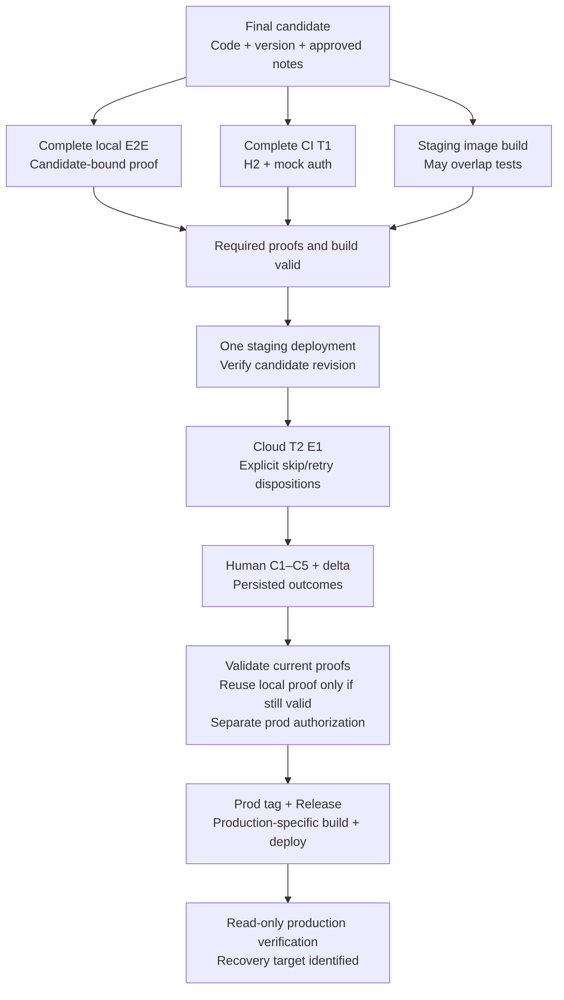
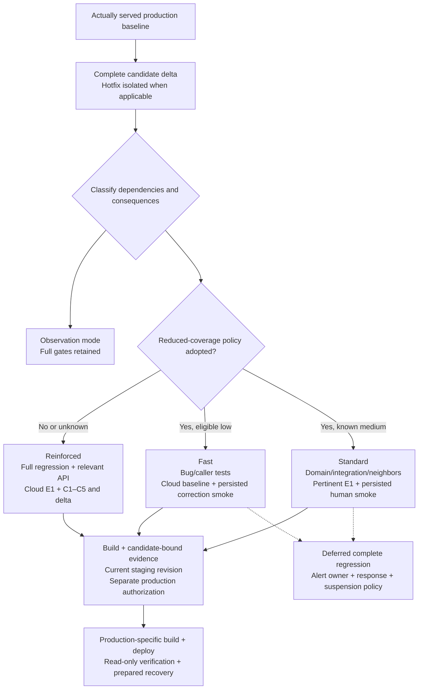

# Process boundaries

These diagrams express proposed contracts, not deployed changes or an implementation schedule. Current topology and the measured before-process remain in the adopted audit. Continuous edges denote verification/data dependencies; dashed edges denote nonblocking observation. Production authorization is always separate.

## Contract A: equivalent coverage

Local and CI remain distinct. Removing a metadata-only intermediate candidate and an identical valid local rerun does not remove a proof environment. API or other controls required by the governing scope remain required even if omitted from this compact diagram.

## Contract B: coverage intentionally selected by blast radius

Reduced coverage accepts potential post-delivery detection outside selected scope. Missing eligibility, mapping confidence or required proof selects reinforced coverage. This diagram does not define proof expiry, fixture waivers, alert ownership or a Git lineage mechanism; Q-1 through Q-5 retain those decisions explicitly.
