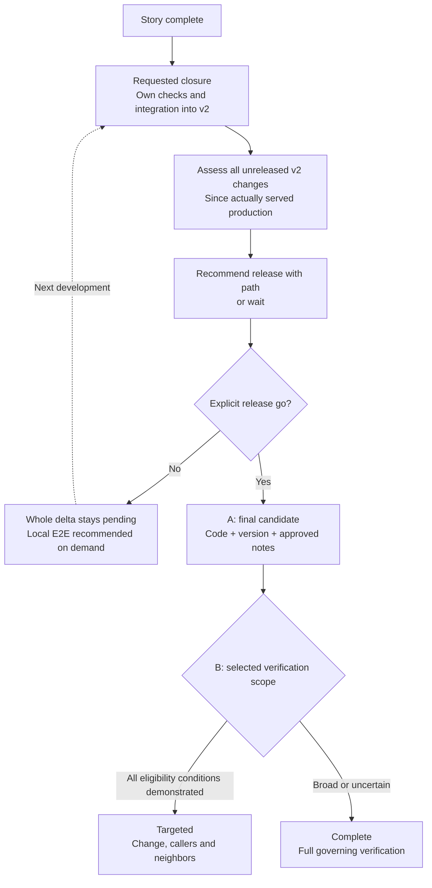
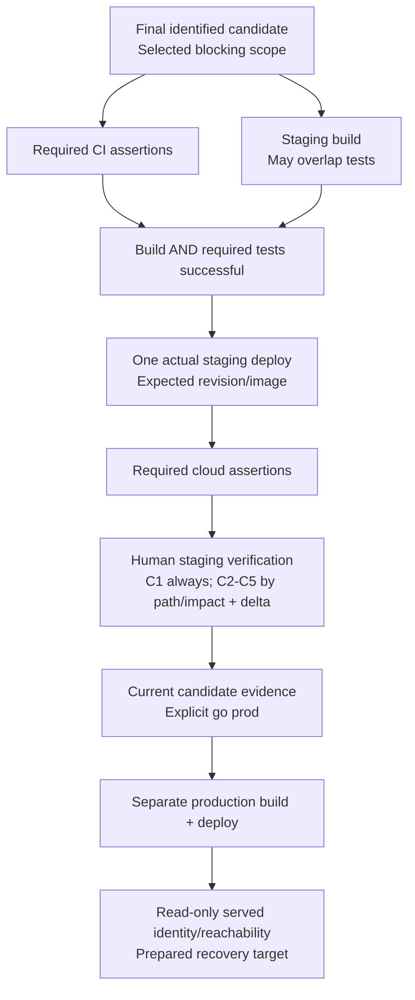
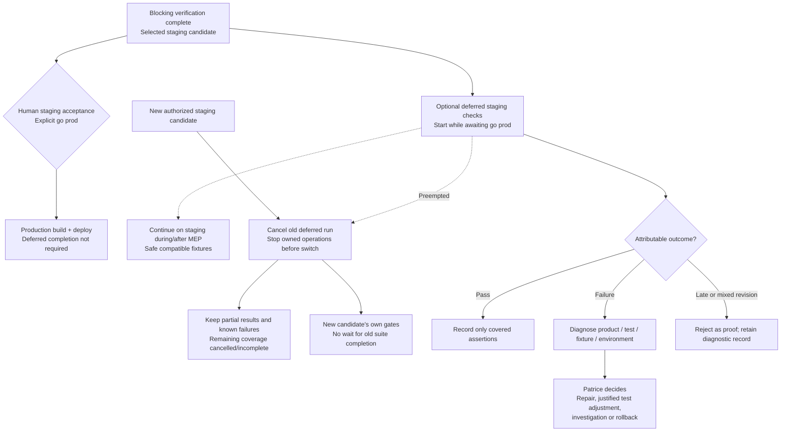

# Target process boundaries

Accepted behavioral target for architecture, not current runtime or implementation order. Q-1–Q-5 retain evidence lookup, exact selectors, validity, residual outcome and recovery mechanics; competing pre-production staging candidates require asking Patrice before replacement.

## Closure and release decision

Existing complete procedures apply until reduced operational rules are adopted/implemented. Story approval/integration CI are distinct from release proof. Go initiates release work without silently removing notes, staging/human or production authority gates.

## Shared mechanism A

Complete retains full T1, relevant API, full governing E1 and C1–C5 plus delta. Both paths retain version/API health/PWA and C1, plus changed/neighbor scenarios; Targeted selects C2–C5 by impact. Later v2 merges do not alter or interrupt this candidate. Resume mechanical failures on the same candidate only after inspecting actual effects. Targeted changes only adopted scope. Final metadata is validated with the candidate; valid proof can be reused, local is on demand, and separate images remain attributable.

## Deferred staging checks, diagnosis and preemption

No automatic rollback/replay or inherited full pass. Cancellation cannot erase observed failures. Deferred tests remain on staging, never production, and do not reserve it through completion. Exact cancellation and fixture/result fencing remain open.
