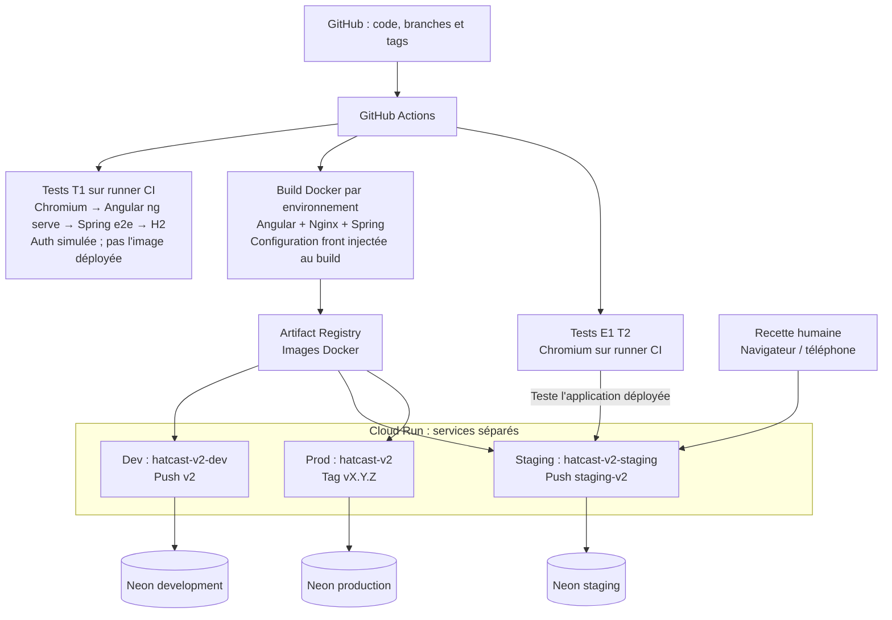
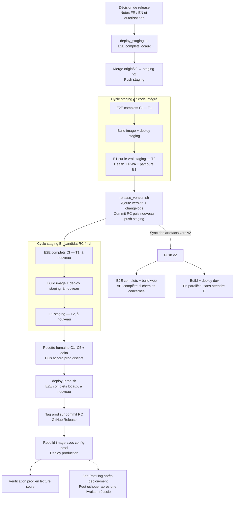
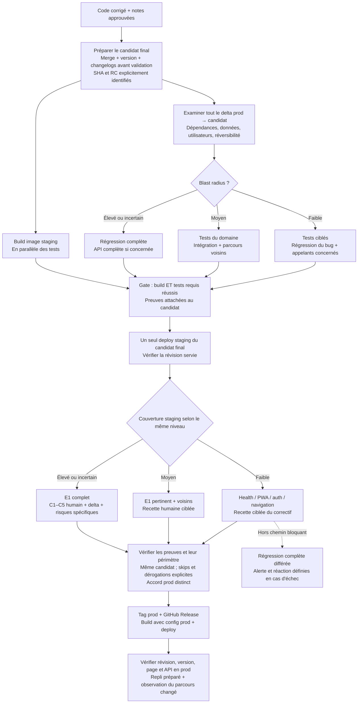

# Audit de la chaîne de release V2 — 23 octobre 2026

Document d'analyse, non normatif. Les parcours proposés ne sont pas activés et
ne remplacent ni les scripts ni les autorisations de la skill de release.
Aucun déploiement, push, tag ou changement de gate n'a été effectué pour cet audit.

## Conclusion

Le délai ressenti d'environ une heure est plausible : le parcours prescrit
cumule deux suites E2E locales, jusqu'à deux cycles staging complets, une
recette humaine et une reconstruction de l'image en production. Il n'est
toutefois pas possible de mesurer « décision → prod » avec les seuls runs CI :
ils ne mesurent ni les contrôles locaux, ni la rédaction/validation des notes,
ni les attentes humaines. Ne pas additionner les workflows parallèles de `v2`.

Les gains les plus solides viennent de la suppression des revalidations sans
nouvelle preuve et de la préparation d'un candidat final avant sa validation.
Un fast path proportionné au risque est pertinent, à condition de classifier
tout le delta livré et de rattacher les preuves au candidat exact.

## Périmètre et méthode

- Checkout initial propre, branche `v2`, HEAD `75ad23d5`.
- Lecture des façades et implémentations staging/RC/prod, de leur bibliothèque
  Git, du Dockerfile, des workflows V2, de la configuration Playwright, des
  projets E1/migration, d'ARCH, du runbook et du contrat de smoke humain.
- Consultation des 60 runs GitHub les plus récents, du 13 au 23 octobre ;
  extraction détaillée des jobs/steps de neuf runs choisis ci-dessous ; logs
  ciblés de cinq jobs pour vérifier les résultats réels.
- Les quatre fichiers structurants suivants sont identiques au `v2` distant
  lors de la lecture : `promote-to-staging.sh`, `promote-tag-to-prod.sh`,
  `deploy-v2-cloud-run.yml`, `e1-preprod-gate.yml`.
- Échantillon descriptif, pas un percentile de performance ni un benchmark.
  Aucun test ou déploiement supplémentaire lancé pour fabriquer des mesures.
- Protections GitHub des branches/environnements, IAM effectif, temps des
  commandes locales et durée de la recette humaine : non vérifiés.

## Lecture visuelle : architecture actuelle et avant / après

Ces schémas distinguent l'infrastructure, le processus exécuté aujourd'hui et
une proposition de processus. Le « après » n'est ni adopté ni implémenté et
ne constitue pas un plan de mise en œuvre. Les flèches continues indiquent une
séquence ou une dépendance ; les flèches pointillées un flux distinct, une
synchronisation ou une activité hors chemin bloquant, selon leur libellé.

### Architecture actuelle : où tournent les tests et l'application ?

Chaque service Cloud Run sert le front Angular via Nginx et son API Spring.
Le schéma montre les cibles configurées ; il ne constitue pas une nouvelle
inspection de l'infrastructure GCP. T1 et T2 peuvent exécuter des scénarios
semblables, mais T2 ajoute la preuve du packaging et de la configuration cloud.
Staging et production sont aujourd'hui reconstruits séparément : les flèches
depuis le registre ne signifient pas qu'ils reçoivent le même digest.

### Avant : chaîne réellement exécutée

Le dessin suit le parcours prescrit lorsque la première gate staging est
attendue avant création de RC. Une RC poussée plus tôt peut annuler le premier
run, sans supprimer le travail déjà consommé.

Les durées locales et humaines ne sont pas mesurées. Les cycles A/B du
23 octobre ont pris respectivement **13:47** et **22:18** ; ils ne sont pas
des durées garanties. Les workflows `v2` sont parallèles et ne doivent pas
être additionnés comme s'ils étaient tous des étapes successives de release.

### Après proposé : un candidat final, des gates selon le blast radius

Le build prod reste visible : cette proposition n'introduit pas implicitement
la promotion d'un digest unique. Celle-ci est une option architecturale
distincte, avec ses propres arbitrages de configuration et de cache PWA.
Le cadre de notes et d'accord prod reste applicable ; le dessin concentre
les changements sur la validation et le candidat.

### Ce qui disparaît, ce qui demeure et le risque accepté

| Avant | Après proposé | Arbitrage |
|---|---|---|
| Deux états staging successivement validés | Un seul candidat final avec sa version et ses notes | On renonce à tester un état intermédiaire qui ne sera pas livré |
| Suites locales rejouées avant promotion | Lecture des preuves CI du candidat exact | Moins de diversité poste/CI ; identité et validité des preuves indispensables |
| Même suite complète pour tous les deltas | Sélection faible / moyen / élevé | Pour faible/moyen, une régression extérieure au périmètre peut être détectée après livraison |
| Build staging après les tests | Build et tests en parallèle, deploy après leurs succès | Du calcul est gaspillé si les tests échouent |
| Staging et recette humaine | Staging conservé, recette proportionnée | Le fast path abandonne le C1–C5 humain intégral ; il conserve le test du correctif |
| Reconstruction prod | Reconstruction prod conservée dans ce schéma | Le délai de build demeure et l'image prod diffère de celle testée en staging |

Pour un hotfix, le candidat de départ serait le tag réellement en production
plus le correctif isolé. Pour une release ordinaire, il peut venir de `v2`.
Dans les deux cas, c'est le delta effectivement livré qui choisit le parcours.
L'éligibilité et les exclusions détaillées figurent plus bas dans l'audit.

## Rôle des contrôles actuels

| Contrôle | Preuve apportée | Limite / répétition |
|---|---|---|
| Build web autonome | Compilation Angular | Reconstruit aussi dans Docker ; pas de `ng test` dans ce workflow |
| Suite API autonome | Régression Spring/H2 | Conditionnée aux chemins API ; indépendante du deploy |
| E2E CI `v2` / PR | Suite fonctionnelle complète, fixtures H2 | Déploiement dev parallèle, sans dépendance à son succès |
| E2E local avant staging | Retour local sur la suite complète | Exécuté avant merge ; pas une preuve du commit staging final |
| E2E CI staging T1 | Suite complète sur le commit staging | Rejouée après création de la RC ; pas sur l'image Cloud Run |
| E1 staging T2 | Vrai packaging, proxy, configuration cloud, auth et Neon staging | Sous-ensemble E1, pas une répétition strictement équivalente de H2 |
| Recette humaine | Parcours permanents C1–C5, persistance et delta produit, responsive | Recouvre certaines actions E1 mais ajoute jugement et résultats persistés |
| E2E local avant prod | Suite complète locale | Aucun checkout explicite du RC, donc preuve potentiellement étrangère au candidat |
| Build prod | Compilation avec arguments de production | Image reconstruite, pas promotion du digest validé en staging |
| PostHog après prod | Référence de release / observabilité | Ne bloque pas un déploiement déjà effectué ; échec global du run possible |

Sources : [workflow deploy](../../../.github/workflows/deploy-v2-cloud-run.yml),
[suite CI](../../../.github/workflows/e2e-smoke.yml),
[gate E1](../../../.github/workflows/e1-preprod-gate.yml),
[Playwright](../../../apps/web/playwright.config.ts),
[script local](../../../scripts/run_e2e.sh),
[contrat humain](../../../.agents/skills/hatcast-v2-release/references/staging-smoke-contract.md).
Les workflows Firebase V1 et la gate migration manuelle ne sont pas des étapes
automatiques supplémentaires du parcours V2 ordinaire.

## Mesures GitHub

Durées par job actif, incluant sa préparation. La durée totale du run peut
ajouter de l'attente de concurrence. Horodatages ci-dessous en heure de Paris.

| Run | Cible | E2E T1 | Build + deploy | E1 T2 | Total run |
|---|---|---:|---:|---:|---:|
| [39897194431](https://github.com/plamarque/hatcast/actions/runs/39897194431) | staging, 23/10 | 4:40 | 4:22 | 4:30 | 13:47 |
| [39899222776](https://github.com/plamarque/hatcast/actions/runs/39899222776) | RC 2.7.0, 23/10 | 12:49 | 4:24 | 4:49 | 22:18 |
| [39105565455](https://github.com/plamarque/hatcast/actions/runs/39105565455) | RC 2.6.3, 18/10 | 4:03 | 4:34 | 4:00 | 16:47 |
| [39100935125](https://github.com/plamarque/hatcast/actions/runs/39100935125) | RC 2.6.3, 18/10 | 5:33 | 4:28 | 5:00 | 19:14 |
| [38865736869](https://github.com/plamarque/hatcast/actions/runs/38865736869) | RC 2.6.2, 16/10 | 5:13 | 4:21 | 4:38 | 17:40 |
| [39130429450](https://github.com/plamarque/hatcast/actions/runs/39130429450) | prod 2.6.3, 18/10 | — | 4:49 | — | 5:17, échec PostHog après deploy réussi |
| [38894694709](https://github.com/plamarque/hatcast/actions/runs/38894694709) | prod 2.6.2, 16/10 | — | 7:07 | — | 7:16 |

Autres points mesurés :

- [E2E v2 du 23/10](https://github.com/plamarque/hatcast/actions/runs/39904800751) :
  job 6:21, dont 5:18 pour la commande Playwright (démarrage des serveurs compris).
- [API complète](https://github.com/plamarque/hatcast/actions/runs/39104917303) :
  11:26 pour le job, dont 11:15 pour Gradle. Ce temps n'est pas automatiquement
  ajouté au chemin staging : la suite tourne dans un workflow indépendant.
- Les builds/pushs Docker staging examinés prennent 2:45–2:55, puis le step
  Cloud Run environ une minute. En prod : 2:56 + 1:25 pour 2.6.3 ; 3:18 + 3:18
  pour 2.6.2. Le step Cloud Run inclut d'autres commandes que le démarrage.
- Les RC des 16 et 18 octobre attendent environ 3:12, 4:01 ou 4:02 avant leur
  premier job actif. Les runs précédents sont annulés au même moment : c'est
  cohérent avec la concurrence/cancellation, sans prouver à elle seule la cause
  exacte de chaque attente.

### Exemple concret : les deux cycles du 23 octobre

Le premier run commence à 05:51:06 et finit à 06:04:53. La RC suivante commence
à 06:14:00 et finit à 06:36:18 : **45:12 écoulées**, dont **36:05 de durées de
runs**, avant recette humaine finale et production. L'intervalle entre les deux
runs n'est pas attribuable aux tests avec ces seules données.

Le diff `916964e5..2c4dbe85` porte uniquement sur six fichiers : les deux
`package.json`, `version.txt`, `changelog.json`, `CHANGELOG.md`, `CHANGELOG_FR.md`.
Ces fichiers ont un effet réel sur le produit et doivent être validés ; ils
n'imposent pas par nature de réexécuter tous les parcours métiers deux fois.

Le second run inclut **8:01 d'installation Chromium**, contre 20–29 secondes
dans les autres jobs T1 détaillés. L'exécution Playwright elle-même prend 4:04.
Cette lenteur ponctuelle n'est donc pas huit minutes de tests supplémentaires.

## Qualité réelle des preuves

1. **« Smoke » désigne aujourd'hui une régression complète.** Le YAML appelle
   `npm run test:e2e` sans filtre ; Playwright sélectionne tous les projets,
   dont E1. Le 23/10 : 104 tests, 99 passed, 1 flaky, 4 skipped. Le 18/10 RC2 :
   98 tests, 92 passed, 2 flaky, 4 skipped. Les quatre tests migration sont
   explicitement exclus hors staging. Un job vert ne veut pas dire premier
   essai propre. Le problème de retry composition existe déjà sous BUG-038.
2. **T1 et T2 ne sont pas interchangeables.** T1 utilise H2, auth Google mockée,
   CSRF désactivé et `ng serve` ; T2 passe par l'application cloud et Neon.
   Leur recouvrement de scénarios ne suffit pas à supprimer T2.
3. **T2 vert ne prouve pas tout le contrat humain.** Les logs T2 examinés donnent
   34 passed / 2 skipped. `E1-MEM-031/032` excluent les écritures/persistance de
   disponibilités sur staging. `E1-ORG-001–002` peut retourner avec une simple
   assertion de visibilité si le tirage n'est pas disponible. La vérification
   complète et persistée de C2/C3 reste distincte.
4. **Une fixture absente peut laisser E1 vert sans Playwright.** Le probe Malice
   est `continue-on-error`, avec warning et skip en cas d'échec. Dans les runs
   détaillés ci-dessus, le probe a réussi et Playwright a bien tourné. Le risque
   concerne le mécanisme, pas une absence observée dans cet échantillon.
5. **Le préflight local prod ne sélectionne pas le RC.** Le script vérifie les
   tags et l'ascendance staging, puis appelle `run_e2e.sh` depuis le checkout
   courant. Il ne vérifie pas `HEAD == RC_COMMIT`. Le même défaut de précision
   existe avant staging : les tests précèdent le merge de `origin/v2`.
6. **La provenance CI est surtout contrôlée par la procédure.** Le script prod
   vérifie la lignée Git ; il ne lit pas lui-même les résultats CI/T2 ni la
   disposition du smoke humain. La skill impose ces vérifications à l'opérateur.
   Les protections externes non inspectées pourraient compléter ce dispositif.
   Le workflow de déploiement staging dépend de T1, pas des workflows autonomes
   de tests API ou de build web. Leur présence dans Actions ne suffit donc pas
   à les qualifier de gates mécaniquement bloquantes de ce déploiement.
7. **Staging est une cible mutable.** E1 vise une URL partagée et sa concurrence
   est indépendante de celle du deploy ; aucune assertion explicite du SHA
   attendu au début/à la fin d'E1 n'apparaît dans le YAML. La skill demande
   l'identification de la révision, mais une nouvelle release pourrait déplacer
   la cible pendant une recette. Aucun incident de ce type n'est établi ici.
8. **La prod est reconstruite.** Même SHA Git ne signifie pas même image : canal
   et configuration front sont injectés au build. Réutiliser directement l'image
   staging demanderait une évolution du contrat de configuration, des métadonnées
   et du cache PWA. Ce n'est pas une optimisation purement mécanique.

Les limites nouvelles sont enregistrées dans ISSUES : LIMIT-011 et LIMIT-012.

## Optimisations et arbitrages proposés

Ce sont des options à décider, pas un nouvel ordre d'exécution approuvé.
Les gains ne s'additionnent pas tous ; certains concernent le coût machine,
d'autres le chemin critique ou seulement sa variance.

| Option | Gain défendable | Preuve conservée / risque accepté |
|---|---|---|
| Préparer merge, version et notes avant un unique push candidat staging | Évite un cycle de l'ordre de 13–15 min actives dans cet échantillon, parfois davantage | Valider le candidat final une fois ; perte de la répétition sur un état intermédiaire. Gérer l'atomicité des refs, la reprise sur erreur et la sync dev |
| Remplacer les E2E locaux de release par une preuve CI valide du candidat | Évite jusqu'à deux suites locales ; durée locale non mesurée | Perte de la diversité poste/CI et du retour avant push. Refuser preuve absente/périmée, SHA différent, workflow ou périmètre incompatibles |
| Ne pas relancer la régression métier sur une sync dev de seuls artefacts de release | Économise un run E2E et éventuellement un deploy dev ; faible gain direct prod si parallèle | Vérifier une liste fermée de fichiers ET le contenu des changements, intégrité des notes, version et lockfile ; aucun contournement pour un changement de dépendance |
| Faire le build d'image en parallèle des E2E T1 | Réduit potentiellement le chemin staging d'environ 3 min | Le deploy doit encore attendre les deux succès ; image construite inutilement en cas de tests rouges ; ne pas déplacer le deploy avant la gate |
| Cache BuildKit / dépendances et installation navigateur mieux maîtrisée | Build actuel ~3 min ; installation navigateur normalement ~25 s, avec un cas à 8 min | Coût de stockage et d'entretien ; clés par lockfile/version, contrôles de fraîcheur ; gain à mesurer, pas promis |
| Régression ciblée pour faible blast radius | Évite la suite complète et E1 non concernés sur le chemin bloquant | Accepte de détecter plus tard une régression hors périmètre ; nécessite une cartographie des dépendances et des tests ciblés crédibles |
| Tests complets hors chemin bloquant du fast path | Garde une détection différée et des tendances | Régression potentiellement visible avant détection ; propriétaire, alerte et réaction obligatoires ; ne remplace pas les tests bloquants du delta |
| Promouvoir un digest unique entre environnements | Évite le rebuild prod (~3 min) et améliore l'identité de l'artefact | Changement architectural : configuration runtime, canaux, client IDs, métadonnées, intégrité service worker ; risque supérieur à un simple cache |
| Plus de workers / sharding | Gain inconnu | Fixtures partagées, suites `serial`, état mutable ; risque de flakiness. Aucune augmentation aveugle recommandée |
| Smoke humain proportionné et trace unique de release | Réduit manipulations et parcours humains non concernés ; durée inconnue | Pour fast path, renoncer explicitement au C1–C5 complet ; conserver une recette du correctif et de sa persistance. Modifier le contrat approuvé |

Les health/PWA prennent quelques secondes : les retirer rapporte peu.
Le job PostHog de 2.6.3 a échoué après deploy réussi ; il faut distinguer
« livraison effectuée » et « observabilité en échec », sans masquer ce dernier.

## Classification par blast radius proposée

Classer le **delta complet entre la prod réellement servie et le candidat**,
pas seulement le dernier commit, le nombre de lignes ou l'urgence du ticket.
Un petit diff dans l'auth, le routeur, un interceptor, les tokens CSS, le service
worker ou un sérialiseur partagé peut toucher toute l'application.

Dimensions à documenter : utilisateurs/rôles concernés, parcours et dépendances
partagés, effets sur les données, effets externes (notifications), détectabilité,
réversibilité et degré de confiance dans l'analyse. Une inconnue relève le niveau.

| Parcours proposé | Éligibilité | Gates bloquantes | Risque résiduel accepté |
|---|---|---|---|
| **Fast / faible** | Changement borné, dépendances comprises, sans migration, auth/permissions, contrat partagé, dépendance, infra ou effet externe ; retour arrière crédible | Diff prod→candidat, review, test de régression du bug, tests ciblés des composants/appelants, build requis, staging candidat + petit smoke auth/navigation/API + parcours changé, contrôle prod après accord | Pas de régression complète ni de C1–C5 humain intégral avant prod ; défaut hors périmètre détecté plus tard |
| **Standard / moyen** | Fonction métier ou parcours local avec plusieurs consommateurs connus, sans risque transversal élevé | Précédentes + intégration concernée, E1 pertinent et voisins, smoke humain ciblé et assertions persistées ; sélection justifiée | Couverture hors domaine partielle ; remonter en renforcé si la sélection devient incertaine |
| **Renforcé / élevé** | Auth, isolation troupe/tenant, permissions, migrations, données critiques, notifications, composition/équité transversale, navigation/cache/PWA globaux, infrastructure ou risque inconnu | Régression complète une fois sur candidat final, API complète si concernée, E1 cloud complet avec fixtures disponibles, C1–C5 + delta humain, migration/compatibilité et retour arrière adaptés | Couverture toujours limitée aux environnements/tests choisis ; acceptations explicites des lacunes |

Un correctif urgent n'est pas automatiquement faible risque. Inversement, un
correctif de récupération d'une vue locale peut être rapide si ses dépendances
et son test de non-régression sont bornés. Un changement de sécurité de deux
lignes reste renforcé.

Le fast path peut garder un staging court : supprimer staging n'est pas
nécessaire pour supprimer les doublons. Un hotfix isolé doit pouvoir partir du
tag réellement en prod avec le seul correctif ; si `v2` contient d'autres
évolutions, le mécanisme actuel `merge origin/v2` ne fournit pas cette isolation.
Il faudra un parcours explicite de candidat hotfix et sa réintégration, sans
écraser les tags ni embarquer involontairement tout `v2`.

## Socle commun proposé pour tous les parcours

- Un candidat identifié (SHA, version et image/digest), le delta depuis la prod,
  la classification justifiée et la liste explicite des contrôles exigés/omis.
- Preuves liées au candidat et au périmètre : workflow, version du contrat de
  tests, résultats y compris retry/skip, configuration cible et dates. Une
  modification du code ou des dépendances invalide les preuves concernées.
- Préflight de promotion qui lit ces preuves, refuse les résultats absents,
  distingue waived/blocked/pass et vérifie que staging sert toujours le candidat.
- Accord prod distinct, prérequis de configuration, contrôles de l'artefact et
  vérification de la révision réellement servie après promotion.
- Repli préparé vers une révision connue ; contrôles auth/API/page/version
  après retour arrière et observation des erreurs du parcours changé.
- Pas de promesse de retour arrière complet : une migration incompatible, une
  notification déjà envoyée ou du JS conservé dans une PWA ne s'annulent pas
  simplement en redirigeant le trafic Cloud Run.

## Objectifs de délai et validation de la proposition

Objectifs exploratoires, **pas des durées déjà obtenues** : fast path
10–15 minutes entre candidat prêt et prod vérifiée, standard 15–25 minutes ;
renforcé piloté par ses gates. Le délai depuis la décision utilisateur inclut
aussi les notes et ses validations ; il doit être mesuré séparément.

Une mesure utile enregistre décision, candidat prêt, début/fin de chaque gate,
attentes humaines et runner, staging disponible, accord prod, trafic prod et
vérification finale. Séparer durée de livraison, minutes runner, flakiness,
échecs de déploiement, retours arrière et défauts échappés. Ne pas annoncer un
gain à partir de la somme de jobs qui tournent en parallèle.

Décisions à prendre : critères d'éligibilité et exclusions du fast path,
couverture minimale sur staging, traitement des retries/skips, mécanisme de
preuve et stratégie hotfix depuis prod. Les fichiers à faire évoluer après
décision incluent scripts, workflows, runbook, skill et contrat de smoke ;
un planning éventuel appartient à PLAN.md. Les règles actuelles restent en
vigueur jusqu'à adoption explicite de ce nouveau contrat.
